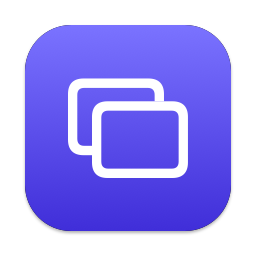

<div align="center">



# VirtualScreen

**More screens, on the one you have.**

Pin live views of any app window above everything else, cropped to exactly what you need.


</div>

---

Working on a single laptop screen, away from your desk? VirtualScreen lives in your menu bar. Pick a window, drag out the part you care about (a chat, a terminal, a video, a dashboard) and it floats as a **mini screen**: live, resizable, always on top. Open as many as you like. Each one stays until you close it.

## ✨ Features

|   |   |
|---|---|
| ✂️ **Just the part you need** | Crop any window down to one region. No toolbars, no sidebars, no wasted space. |
| 🔴 **Live** | Mini screens update in real time at 5, 10, 15 or 30 fps. |
| 📌 **Always on top** | Floats above every window, across all desktops and over full-screen apps. |
| ↔️ **Resize freely** | Drag any edge or corner. The aspect ratio is kept, and the view stays sharp. |
| ♾️ **As many as you want** | No limit on how many mini screens you open at once. |
| 💾 **Remembers your layout** | Mini screens come back where you left them after a relaunch. |
| 🪟 **Liquid Glass** | Native macOS 26 design, with a blur material on macOS 14 and 15. |
| 🪶 **Lightweight** | Captures only the cropped area at the size it's shown, hands frames straight to the GPU, and pauses when hidden. No Dock icon, no network access. |

## 🚀 Getting started

**Requirements:** macOS 14 Sonoma or later, and the Xcode Command Line Tools (`xcode-select --install`).

```sh
git clone https://github.com/faithere1/VirtualScreen.git
cd VirtualScreen
./build.sh
open VirtualScreen.app
```

On first launch, allow VirtualScreen under **System Settings → Privacy & Security → Screen & System Audio Recording**, then relaunch it. The menu bar panel has a **Relaunch** button for this.

> **Note:** `build.sh` creates a local code signing certificate named *VirtualScreen Local Signing* in your login keychain the first time it runs. This keeps the Screen Recording permission valid across rebuilds. If macOS asks whether `codesign` may use it, choose **Always Allow**.

> **Tip:** To start VirtualScreen at login, add it under **System Settings → General → Login Items**.

## 🖱 Usage

| Action | How |
|---|---|
| New mini screen | Click the menu bar icon, then pick a window |
| Select an area | Drag over the preview, or click to use the whole window |
| Cancel selection | Press `Esc` |
| Move | Drag the mini screen anywhere |
| Resize | Drag any edge or corner |
| Close | Hover, then click ✕ |
| Refresh rate | Bottom of the menu bar panel |
| Close all / Quit | Right-click the menu bar icon |

## 🧱 Project structure

```
Sources/
├── main.swift            # menu bar icon, menu, permissions
├── WindowPicker.swift    # window list and refresh-rate control (SwiftUI)
├── RegionSelector.swift  # drag-to-crop overlay
├── MiniWindow.swift      # the floating mini screen: move, resize, close
├── CaptureStream.swift   # ScreenCaptureKit stream, zero-copy frames
├── Glass.swift           # Liquid Glass with a fallback for older macOS
└── Store.swift           # settings and saved layout
Tools/
└── make_icon.swift       # renders the app icon
build.sh                  # builds and signs VirtualScreen.app
```

Built with Swift, AppKit, SwiftUI and ScreenCaptureKit only. No third-party dependencies.

## ⚠️ Known limitations

- Mini screens are **view-only**. Click the real window to interact with it.
- If a source window is minimized, its mini screen freezes on the last frame until the window is restored.
- After a relaunch, each mini screen reconnects to a window of the same app, matched by title when possible.

## 📄 License

[MIT](LICENSE) © faithere1

---

<div align="center">
<sub>Made for people who need one more screen.</sub>
</div>
